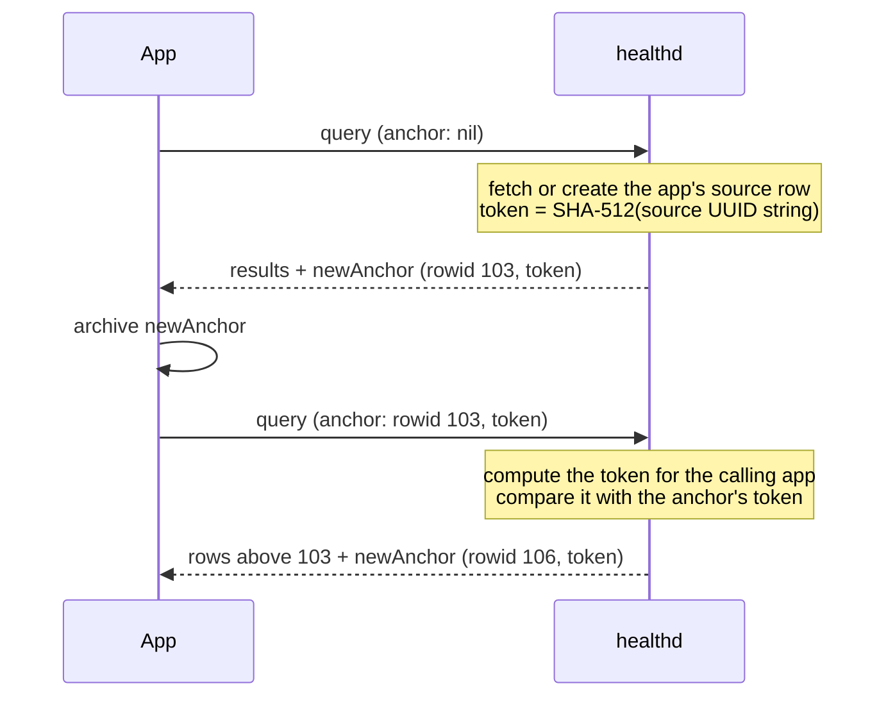
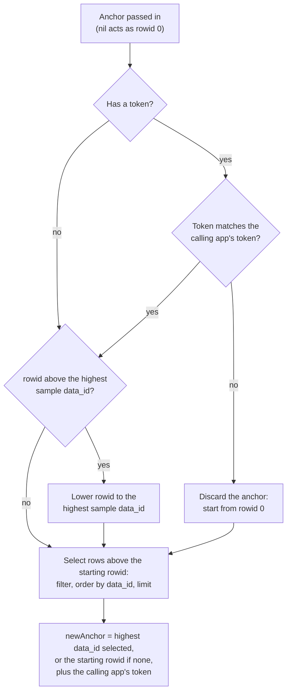

# How HKQueryAnchor works

Apple calls an anchor "a specific point in time in the evolution of the health database" ([WWDC20: Synchronize health data with HealthKit][wwdc20]) and documents the type as opaque. This document builds up what that point is in three steps: what an anchor is, what its two values mean, and how a query uses them.

## Summary

An `HKQueryAnchor` holds two values: a row number from one device's Health database, and a token for the app that received it. A query selects the rows numbered above the anchor's row number: new samples and records of deleted samples. The new anchor it returns holds the highest row number it selected.

## Contents

- [Sources and confidence](#sources-and-confidence)
- [What an anchor is](#what-an-anchor-is)
  - [Where the numbers come from](#where-the-numbers-come-from)
  - [What a deletion writes](#what-a-deletion-writes)
  - [Synced samples](#synced-samples)
- [What an anchor's values mean](#what-an-anchors-values-mean)
  - [`rowid`: where the last query stopped](#rowid-where-the-last-query-stopped)
  - [`clientToken`: the app that received the anchor](#clienttoken-the-app-that-received-the-anchor)
  - [The values an anchor can take](#the-values-an-anchor-can-take)
- [How the values shape a query](#how-the-values-shape-a-query)
  - [`rowid` selects the rows](#rowid-selects-the-rows)
  - [`newAnchor` holds the highest row selected](#newanchor-holds-the-highest-row-selected)
  - [A `rowid` above the newest row](#a-rowid-above-the-newest-row)
  - [A token from another app](#a-token-from-another-app)
  - [The order of the steps](#the-order-of-the-steps)
- [Deletion records in the results](#deletion-records-in-the-results)
  - [The per-app baseline](#the-per-app-baseline)
  - [Pruning](#pruning)
  - [The predicate applies only to samples](#the-predicate-applies-only-to-samples)
- [References](#references)

## Sources and confidence

Most of this document comes from closed-source code. Sections end with a collapsed **Sources** block that lists their claims, each with a tag for where it comes from:

- **Documented**: public documentation states it. The entry links to it.
- **Observed**: read from the HealthKit or HealthDaemon binary. The entry names the function, string, or constant.
- **Tested**: run on macOS 26.5.1.
- **Inferred**: follows from observed code, but not run. The entry names the code it rests on.

The closed-source material comes from two places:

- **macOS 26.5.1 (25F80).** HealthKit (the client library) and HealthDaemon (the code that runs in the Health daemon, `healthd`), disassembled from the dyld shared cache with `dyld_info -disassemble`. Strings, instance variables, and constant values come from a running process that loads both frameworks.
- **iOS 26.1 (23B85) and iOS 18.2 (22C152).** Decompiled binaries that third parties publish at [EthanArbuckle/iPhone18-3_26.1_23B85_Restore][ios261] and [EthanArbuckle/iPhone17-1_18.2_22C152_Restore][ios182]. The iOS 26.1 code matches the macOS code for the token check, the anchor clamp, the deletion insert, and the pruning rule. To find the iOS version of an Observed claim, search these repos for the symbol in its entry. Decompiler output can contain errors.

Values that can differ between releases, such as retention periods, carry the build they come from.

## What an anchor is

Each device's Health database numbers its changes in the order they happen. Adding a sample, deleting a sample, and receiving a sample synced from another device each take the next number. The database never reuses a number. An anchor holds one of these numbers. A query returns the changes numbered above it, in number order, and a new anchor that holds the number where it stopped.

```text
 #    change                           steps queries
101   step sample A added              ┐ 1st query, anchor nil:
102   heart rate sample B added        │ returns A and C,
103   step sample C added              ┘ new anchor 103
──────────────────────────────────────── anchor 103
104   step sample D added              ┐ 2nd query, anchor 103:
105   step sample A deleted            │ returns D, the deletion of A,
106   step sample E synced from Watch  ┘ and E; new anchor 106
```

The subsections below show how the database assigns these numbers.

### Where the numbers come from

Health stores its data in a SQLite database on each device. Two of its tables hold samples:

- **`objects`** has a row for every sample and every deletion record. The row's number, `data_id`, is the number from the list above. The row also holds the sample's UUID and a `type`: `1` for a sample, `2` for a deletion record.
- **`samples`** has a row with the same `data_id`. It holds the sample type (`data_type`), such as steps or heart rate, and the start and end dates.

```text
objects                         samples
data_id  type  uuid             data_id  data_type
101      1     A     ────────── 101      steps
102      1     B     ────────── 102      heart rate
103      1     C     ────────── 103      steps
```

The numbers come from `objects`, so steps, heart rate and every other sample type share one sequence. Each new row gets a number higher than any row before it. The database doesn't reuse the number of a removed row.

The rest of this document shows a sample's two rows as one line:

```text
data_id  type  data_type    uuid
101      1     steps        A
102      1     heart rate   B
103      1     steps        C
```

A new sample takes the next number. The iPhone records step sample D:

```diff
  data_id  type  data_type    uuid
  101      1     steps        A
  102      1     heart rate   B
  103      1     steps        C
+ 104      1     steps        D
```

<details>
<summary>Sources</summary>

- **One database per device.** Inferred from: the sync receive path `+[HDDataSyncEntity receiveSyncObjects:version:syncStore:profile:error:]` inserts objects from other devices into the local database. Documented: Apple DTS says anchors are per device: "`HKQueryAnchor` is per-device, and hence is not supposed to be used across devices." ([Developer Forums thread 772941][dts])
- **SQLite.** Observed: HealthDaemon writes rows through SQLite's `sqlite3_bind_*` functions, for example in `+[HDDeletedSampleEntity insertDeletedObject:dataType:…]`. [Plaso's iOS Health parser][plaso] reads the file as a SQLite database.
- **`objects` and `samples` tables.** Observed: `+[HDDataEntity databaseTable]` returns `objects` and `+[HDSampleEntity databaseTable]` returns `samples`; SQL strings in HealthDaemon join them `USING (data_id)`. [Plaso][plaso] lists both tables.
- **Numbers only go up.** Observed: the `objects` schema declares `data_id INTEGER PRIMARY KEY AUTOINCREMENT`.
- **`type` values.** Observed: index `objects_deleted ON objects (type) WHERE (objects.type = 2)`; `_HDDataEntityPredicateForType` called with `1` and `2` in `-[HDDataEntityEnumerator _prepareDeletedObjectsAndSamplesDescriptor:error:]`. [iLEAPP][ileapp] notes: "Rows whose objects.type is 2 are not reported."

</details>

### What a deletion writes

Deleting a sample removes its row and inserts a deletion record: a new row with the same UUID and `type = 2`. The deletion record also gets a `samples` row with the sample's data type, so type filters apply to it.

The deletion record takes the next row number. The user deletes step sample A:

```diff
  data_id  type  data_type    uuid
- 101      1     steps        A
  102      1     heart rate   B
  103      1     steps        C
  104      1     steps        D
+ 105      2     steps        A
```

Row 105 sorts after every row that existed when the deletion happened.

<details>
<summary>Sources</summary>

- **Removal, then a new row.** Observed: `-[HDDataEntityDeletionContext deleteObjectWithPersistentID:objectUUID:entityClass:objectType:…]` calls `deleteObjectWithPersistentID:entityClass:error:`, then `+[HDDeletedSampleEntity insertDeletedObject:dataType:provenanceIdentifier:deletionDate:…]`.
- **`type = 2`, new row number.** Observed: `+[HDDeletedObjectEntity insertDeletedObject:provenanceIdentifier:deletionDate:inDatabase:error:]` binds `type` to `2` and returns the new row's number.
- **`samples` row with the data type.** Observed: the insert block of `+[HDDeletedSampleEntity insertDeletedObject:dataType:…]` builds `INSERT INTO samples (data_id, data_type, start_date, end_date)` from `HDSampleEntity`'s table and properties.

</details>

### Synced samples

Samples from another device or from iCloud become rows in this device's database when they arrive, so they take this device's next row numbers, whatever their sample dates.

A step sample E that Apple Watch recorded last week syncs to the phone:

```diff
  data_id  type  data_type    uuid
  102      1     heart rate   B
  103      1     steps        C
  104      1     steps        D
  105      2     steps        A
+ 106      1     steps        E      (recorded last week on Apple Watch)
```

<details>
<summary>Sources</summary>

- **Local row numbers for synced samples.** Inferred from: `AUTOINCREMENT` on `data_id`; the sync receive path `+[HDDataSyncEntity receiveSyncObjects:version:syncStore:profile:error:]` and `+[HDDataSyncEntity _insertObjectsFromCodableObjectCollection:syncStore:profile:error:]`.

</details>

## What an anchor's values mean

`HKQueryAnchor` is an Objective-C class with two private instance variables:

```text
HKQueryAnchor
├── _rowid        Int64     a data_id from the objects table
└── _clientToken  String?   SHA-512 hash of the receiving app's source UUID
```

<details>
<summary>Sources</summary>

- **Instance variables.** Observed: the class's instance-variable list at runtime; `-[HKQueryAnchor _rowid]`. Documented: [`HKQueryAnchor`][hkqueryanchor] lists neither variable.

</details>

### `rowid`: where the last query stopped

`rowid` is a `data_id` from the `objects` table. A query returns a new anchor whose `rowid` is the highest row it selected, so the value records where that query stopped in the list. The next query with this anchor starts after that row.

`rowid` is the whole position. The anchor holds no sample type, predicate, date, or device identifier. All sample types share one number sequence, so one row number marks a position for every type.

<details>
<summary>Sources</summary>

- **A `data_id`.** Observed: `-[HDDataEntityEnumerator _prepareDeletedObjectsAndSamplesDescriptor:error:]` compares `data_id` (`HDDataEntityPropertyDataID`) with the anchor's value.

</details>

### `clientToken`: the app that received the anchor

Each device's Health database has a `sources` table with one row per app, identified by a random UUID. The public [`HKSource`][hksource] class exposes the app's name and bundle identifier, not this UUID.

healthd builds the token from that UUID and attaches it to every anchor it returns, so the token records which app the anchor belongs to:



healthd checks the token before it uses `rowid` (see [A token from another app](#a-token-from-another-app)).

<details>
<summary>Sources</summary>

- **`sources` table with a random UUID.** Observed: schema string `CREATE TABLE IF NOT EXISTS sources (ROWID INTEGER PRIMARY KEY AUTOINCREMENT, uuid BLOB UNIQUE NOT NULL, bundle_id TEXT NOT NULL, …`; `-[HDSourceManager createOrUpdateSourceForClient:error:]` reaches `-[HDSourceManager _createSourceEntityForBundleIdentifier:…]`, which gets the UUID from `+[NSUUID UUID]`. Documented: SDK header `NSUUID.h`, "Create a new autoreleased NSUUID with RFC 4122 version 4 random bytes."
- **Token from the source UUID.** Observed: `-[HDAnchoredObjectQueryServer prepareToActivateServerWithError:]` calls `createOrUpdateSourceForClient:error:` and `sourceUUIDWithProfile:error:`; `-[HDAnchoredObjectQueryServer _queue_secureClientTokenWithError:]` calls `hk_SHA512Hash` on the UUID string.
- **Token on every returned anchor.** Observed: `-[HDAnchoredObjectQueryServer _queue_deliverSamples:deletedObjects:anchor:…]` calls `_setClientToken:`.

</details>

### The values an anchor can take

| Anchor                        | `rowid`                            | Token               |
|-------------------------------|------------------------------------|---------------------|
| `newAnchor` from a query      | the highest row the query selected | the receiving app's |
| `nil`                         | 0                                  | none                |
| `HKQueryAnchor(fromValue: n)` | `n`                                | none                |
| `latestAnchor` (private)      | `Int64.max`                        | none                |

`init(fromValue:)` converts the integer anchors that queries returned before iOS 9 ([`init(fromValue:)`][fromvalue]).

`latestAnchor` is a class method that the public SDK doesn't declare. Its `rowid` is above every row; [A `rowid` above the newest row](#a-rowid-above-the-newest-row) shows what a query does with it. On 64-bit devices, `HKQueryAnchor(fromValue: Int.max)` builds an equal anchor.

<details>
<summary>Sources</summary>

- **`nil` as 0.** Observed: `-[HDDataEntityEnumerator _prepareDeletedObjectsAndSamplesDescriptor:error:]` reads the anchor with `longLongValue`, which returns 0 for `nil`, and adds `data_id > anchor` only when the value is 1 or more.
- **`init(fromValue:)`.** Observed: `+[HKQueryAnchor anchorFromValue:]` calls the private `+_anchorWithRowid:` with the value and sets no token. Documented: [`init(fromValue:)`][fromvalue].
- **`latestAnchor`.** Observed: `+[HKQueryAnchor latestAnchor]` sets `rowid` to `0x7FFFFFFFFFFFFFFF` and sets no token; no SDK header declares it. Tested: printed it and `HKQueryAnchor(fromValue: Int.max)`; both show `rowid` 9223372036854775807 and no token, and `isEqual:` returns `YES`.

</details>

## How the values shape a query

healthd runs every anchored query. This section starts with the common case, an anchor from the app's own last query. It then covers the two cases where healthd replaces the anchor before using it.

### `rowid` selects the rows

healthd selects rows with a filter built from predicate objects. In SQL terms:

```sql
WHERE data_type IN (<the query's sample types>)
  AND data_id > :anchor                    -- left out when the anchor is below 1
  AND (
        (type = 1 AND <the query's predicate> AND <read authorization>)
     OR (type = 2 AND data_id > :deletionBaseline)      -- see "Deletion records in the results"
      )
ORDER BY data_id ASC
LIMIT :limit
```

Rows come back in the order they entered this device's database, not in sample-date order. Rows that fail the filter aren't returned and don't count toward the new anchor.

`limit` caps both kinds of row together. A query with `limit: 2` returns up to 2 rows, in any mix of samples and deletion records.

> [!NOTE]
> The web pages for [`init(type:predicate:anchor:limit:resultsHandler:)`][aoq-init] and [`init(predicates:anchor:limit:)`][desc-init] describe `limit` as the maximum number of *samples*. The SDK header and the code count deletion records too.

In the example, the app queries steps with its anchor at 103 and `limit: 2`:

```text
 #    change                             result
103   step sample C added                not above the anchor
──────────────────────────────────────── anchor 103
104   step sample D added              ┐ selected: D in addedSamples,
105   step sample A deleted            ┘ the deletion of A in deletedObjects
106   step sample E synced from Watch    not selected: past the limit
```

<details>
<summary>Sources</summary>

- **Filter.** Observed: `-[HDDataEntityEnumerator _prepareDeletedObjectsAndSamplesDescriptor:error:]`. It adds `data_id > anchor` only when the anchor's `longLongValue` is 1 or more, and adds `data_id > baseline` to the `type = 2` branch under the same check.
- **Order.** Observed: `-[HDAnchoredObjectQueryServer _batchObjectsWithAnchor:error:batchHandler:]` sorts by `HKObjectSortIdentifierDataID`, ascending.
- **`limit` counts both kinds.** Documented: SDK header `HKAnchoredObjectQuery.h`, "The maximum number of samples and deleted objects to return." Observed: the enumerator that returns both kinds has one row limit, set with `setLimitCount:`.

</details>

### `newAnchor` holds the highest row selected

`newAnchor` holds the highest `data_id` among the selected rows and the calling app's token. If no row matches, it holds the starting `rowid`.

In the example, the query selects D and the deletion of A, so `newAnchor` holds 105. The next query, from 105, selects E and returns a `newAnchor` at 106.

<details>
<summary>Sources</summary>

- **Highest `data_id`, or the starting `rowid`.** Observed: a block in `-[HDBatchedQueryServer batchObjectsWithEnumerator:includeDeletedObjects:error:batchHandler:]` keeps the highest `data_id` seen, starting from the enumerator's anchor; a block in `-[HDAnchoredObjectQueryServer _queue_startForInitialResults]` builds the anchor with `+_anchorWithRowid:`.

</details>

### A `rowid` above the newest row

Before it selects rows, healthd reads the highest `data_id` among sample rows. If the anchor's `rowid` is higher, healthd replaces the anchor with one at that `data_id`. An anchor from `latestAnchor` therefore starts at the newest existing row, and so does one from `HKQueryAnchor(fromValue: Int.max)`.

In the example, a steps query with `latestAnchor` starts at 106. It selects no rows, so its `newAnchor` holds 106, and the query after it selects only rows added after 106.

<details>
<summary>Sources</summary>

- **Lowering.** Observed: `-[HDAnchoredObjectQueryServer _queue_start]` calls `+[HDSampleEntity maxRowIDForPredicate:healthDatabase:error:]`, compares the result with `_rowid`, and calls `+_anchorWithRowid:`.

</details>

### A token from another app

Before it lowers or uses `rowid`, healthd compares the anchor's token with the calling app's token. If they differ, healthd logs "Invalidating stale query anchor" and runs the query as if the anchor were `nil`, from the first row. An anchor without a token, such as one from `init(fromValue:)` or `latestAnchor`, skips this check.

<details>
<summary>Sources</summary>

- **Token check and discard.** Observed: `-[HDAnchoredObjectQueryServer _queue_start]`, including the log string.

</details>

### The order of the steps

healthd applies the steps from this section in this order:



## Deletion records in the results

Deletion records pass the same `rowid` filter as samples. Three more rules decide which of them a query returns.

### The per-app baseline

healthd stores each app's Health permissions in an `authorization` table, one row per app and sample type. The row also has a `deleted_object_anchor` column. Each time healthd writes the row, it stores the highest `data_id` in the database in that column. healthd writes the row when access changes: when the app calls [`requestAuthorization(toShare:read:completion:)`][request-auth], and when statuses are written from outside the app.

Two apps get read access to steps at different points:

```text
 #    change
101   step sample A added
102   step sample B added
───────────────────────── first app gets access: highest row is 102
103   step sample A deleted
───────────────────────── second app gets access: highest row is 103
104   step sample C added
```

The `authorization` table holds one steps row for each app:

```text
app         object_type  deleted_object_anchor
first app   steps        102
second app  steps        103
```

A query uses the stored value for its sample type as the deletion baseline. Deletion records at or below it aren't returned. The baseline applies only to deletion records, so samples at or below it are still returned. It also applies with a `nil` anchor, which removes only the `data_id > :anchor` condition: a first query returns the stored deletion records above the baseline. Apple's docs say the same: "Pass `nil` to receive all the matching samples and recently deleted objects currently in the HealthKit store." ([`init(type:predicate:anchor:limit:resultsHandler:)`][aoq-init]).

Each app runs a first steps query, with a `nil` anchor and no limit:

| data_id | change             | First app (baseline 102) | Second app (baseline 103)  |
|--------:|--------------------|--------------------------|----------------------------|
| 102     | B added            | Returned                 | Returned                   |
| 103     | A deleted          | Returned                 | Excluded: at the baseline  |
| 104     | C added            | Returned                 | Returned                   |

<details>
<summary>Sources</summary>

- **`deleted_object_anchor` column.** Observed: schema string `CREATE TABLE IF NOT EXISTS authorization (… object_type INTEGER NOT NULL, … deleted_object_anchor INTEGER NOT NULL DEFAULT 0, … UNIQUE(source_id, object_type))`.
- **Highest `data_id` stored on each write.** Observed: `+[HDAuthorizationEntity setAuthorizationStatuses:authorizationRequests:authorizationModes:sourceEntity:options:profile:error:]` reads `+[HDAuthorizationEntity _maxObjectPersistentIDForProfile:error:]` and passes it as `objectAnchor:` to `+[HDAuthorizationEntity _insertAuthorizationWithSourceIdentifier:…]`.
- **When healthd writes the row.** Inferred from the callers' names: `-[HDAuthorizationManager _authorizationRequestStatusForClientBundleIdentifier:writeTypes:readTypes:updateAuthorizationStatuses:error:]`, `-[HDAuthorizationStoreWriteServer remote_setAuthorizationStatuses:authorizationModes:forBundleIdentifier:options:completion:]`.
- **Used as the baseline.** Observed: `-[HDBatchedQueryServer batchObjectsWithEnumerator:includeDeletedObjects:error:batchHandler:]` passes `deletedObjectBaselineAnchor` to `setDeletedObjectsAnchor:` when the authorization record has no restricted bundle identifier.
- **Deletion records with a `nil` anchor.** Observed: `-[HKAnchoredObjectQuery initWithQueryDescriptors:anchor:limit:resultsHandler:]` sets `_includeDeletedObjects` to `YES` whatever the anchor.

</details>

### Pruning

Apple: "Deleted objects are temporary; the system may remove them from the HealthKit store at any time to free up space." ([`HKDeletedObject`][deleted]). The pruning rule in the code:

```text
remove a deletion record when
  creation_date (the deletion time) is more than HKDeletedSamplesAvailableDays ago
  and data_id ≤ the lowest anchor acknowledged by every sync store
      updated in the last 28 days
```

`HKDeletedSamplesAvailableDays` is 14 on macOS 26.5.1. Sync stores are rows in the `sync_stores` table, and iCloud stores also have a row in `cloud_sync_stores`. App anchors aren't part of the rule.

<details>
<summary>Sources</summary>

- **Pruning rule.** Observed: `+[HDDeletedSampleSyncEntity _basePruningPredicateForDate:profile:]` passes `HKDeletedSamplesAvailableDays` to `hd_predicateForDeletedObjectsCreatedBeforeDate:minusDays:`; `+[HDDataSyncEntity _pruningPredicateWithDate:profile:anchor:]` excludes rows above the sync anchor.
- **`creation_date` holds the deletion time.** Observed: `+[HDDeletedObjectEntity insertDeletedObject:provenanceIdentifier:deletionDate:inDatabase:error:]` binds `creation_date` to the deletion date.
- **28 days.** Observed: `-[HDDatabasePruningTask _minimumFrozenAnchorMapForPruningDate:error:]` reads the lowest sync anchors updated within the last 2,419,200 seconds.
- **14 days.** Tested: value of `HKDeletedSamplesAvailableDays` read at runtime.
- **Sync stores.** Observed: `sync_stores` and `cloud_sync_stores` schema strings.

</details>

### The predicate applies only to samples

In the filter, the query's predicate appears only in the `type = 1` branch. A deletion record passes on its type, the anchor, and the baseline.

> [!NOTE]
> The [`init(type:predicate:anchor:limit:resultsHandler:)`][aoq-init] page describes the predicate as one "that filters both the samples and the deleted objects returned by the query." In the code, it filters samples only.

<details>
<summary>Sources</summary>

- **Predicate on samples only.** Observed: the predicate reaches the enumerator as its `_filter`, and `-[HDDataEntityEnumerator _prepareDeletedObjectsAndSamplesDescriptor:error:]` adds `_filter` only to the `type = 1` branch. The single-descriptor path doesn't set a separate deletion predicate with `setDeletedObjectsPredicate:`.

</details>

## References

Apple:

- [WWDC20: Synchronize health data with HealthKit][wwdc20]
- [`HKQueryAnchor`][hkqueryanchor]
- [`HKQueryAnchor.init(fromValue:)`][fromvalue]
- [`HKAnchoredObjectQuery.init(type:predicate:anchor:limit:resultsHandler:)`][aoq-init]
- [`HKAnchoredObjectQueryDescriptor.init(predicates:anchor:limit:)`][desc-init]
- [`HKDeletedObject`][deleted]
- [`HKSource`][hksource]
- [`HKHealthStore.requestAuthorization(toShare:read:completion:)`][request-auth]
- [Developer Forums: Can I use an HKQueryAnchor across multiple devices?][dts]
- SDK headers `HKQueryAnchor.h` and `HKAnchoredObjectQuery.h`, iOS 26.5 SDK (`HealthKit.framework/Headers/` in Xcode)

Third-party:

- [Plaso: iOS Health parser][plaso]
- [iLEAPP: health.py][ileapp]
- [EthanArbuckle/iPhone18-3_26.1_23B85_Restore][ios261] (decompiled iOS 26.1)
- [EthanArbuckle/iPhone17-1_18.2_22C152_Restore][ios182] (decompiled iOS 18.2)

[wwdc20]: https://developer.apple.com/videos/play/wwdc2020/10184/
[hkqueryanchor]: https://developer.apple.com/documentation/healthkit/hkqueryanchor
[fromvalue]: https://developer.apple.com/documentation/healthkit/hkqueryanchor/init(fromvalue:)
[aoq-init]: https://developer.apple.com/documentation/healthkit/hkanchoredobjectquery/init(type:predicate:anchor:limit:resultshandler:)
[desc-init]: https://developer.apple.com/documentation/healthkit/hkanchoredobjectquerydescriptor/init(predicates:anchor:limit:)
[deleted]: https://developer.apple.com/documentation/healthkit/hkdeletedobject
[hksource]: https://developer.apple.com/documentation/healthkit/hksource
[request-auth]: https://developer.apple.com/documentation/healthkit/hkhealthstore/requestauthorization(toshare:read:completion:)
[dts]: https://developer.apple.com/forums/thread/772941
[plaso]: https://plaso.readthedocs.io/en/latest/_modules/plaso/parsers/sqlite_plugins/ios_health.html
[ileapp]: https://github.com/abrignoni/iLEAPP/blob/main/scripts/artifacts/health.py
[ios261]: https://github.com/EthanArbuckle/iPhone18-3_26.1_23B85_Restore
[ios182]: https://github.com/EthanArbuckle/iPhone17-1_18.2_22C152_Restore
